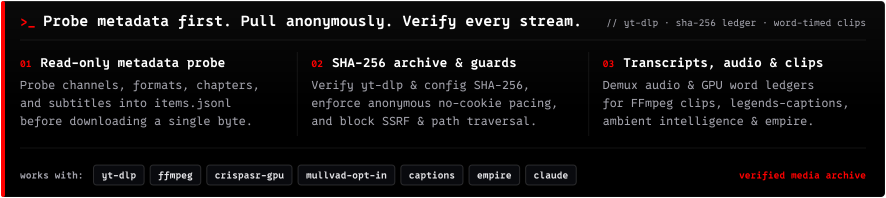
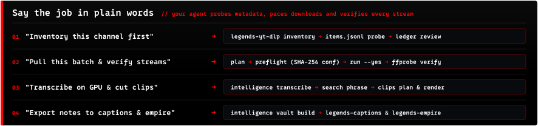
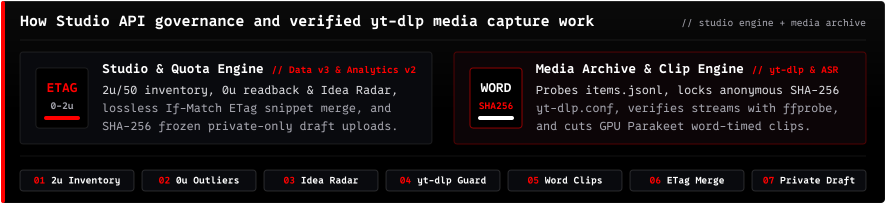

<a name="banner"></a>
<a name="legends-youtube"></a>

# 

[](https://github.com/avalonreset/legends-youtube/releases/latest)
[](https://github.com/avalonreset/legends-youtube/actions/workflows/ci.yml)
[](docs/RELEASE.md)
[](docs/AGENT-RECIPE.md)
[](LICENSE)

**Unified YouTube Data API v3, Analytics API v2, Studio packaging, and verified `yt-dlp` media archiving CLI (`legends-youtube` + `legends-yt-dlp`) for coding agents: inventory channels at 2 quota units per 50 videos, scout breakout outliers and verify live public videos for 0 quota units, score ideas before recording with the Perfect Video Score and Goldilocks timing rule, probe and pull media via anonymous SHA-256-guarded `yt-dlp` batches with `ffprobe` stream verification and GPU Parakeet word-timed clips, execute lossless `If-Match` ETag snippet merges with rollback snapshots, upload SHA-256 frozen private-only drafts, and attach an 18-file YouTube Operations Vault to [`legends-empire`](https://github.com/avalonreset/legends-empire).**


```text
Install or update legends-youtube via cto-legends (https://github.com/avalonreset/cto-legends): run `cto-legends install legends-youtube --apply`, then `cto-legends handoff legends-youtube` and follow the returned JSON recipe to verify `legends-youtube doctor --json` and `legends-yt-dlp doctor --offline`.
```



## Why `legends-youtube` exists

Improvised agent scripts, raw YouTube API calls, and ad-hoc `yt-dlp` invocations break production channels and media archives in four predictable ways:

1. **The `videos.update` partial-update trap wipes omitted tags and descriptions:** Calling `PUT /youtube/v3/videos?part=snippet` replaces the entire `snippet` object. Any mutable property omitted from the payload (`description`, `tags`, `defaultLanguage`, `defaultAudioLanguage`) is silently deleted by YouTube, while blind writes overwrite concurrent Studio edits.
2. **100-unit `search.list` quota bombs exhaust the daily pool:** Google Cloud projects receive a 10,000-unit daily pool plus 2026-06-01 granular daily caps (`100` `search.list` calls/day and `100` `videos.insert` calls/day). Using `search.list` to list a channel's videos burns 100 units per page, and using authenticated API calls just to verify a public video's live metadata wastes quota needed for real writes.
3. **Ad-hoc `yt-dlp` shell calls leak browser cookies, skip stream checks, and chop clips mid-word:** Passing `--cookies-from-browser chrome` or unvetted flags into raw shell loops exposes personal accounts to automated rate limits, skips pre-download `items.jsonl` metadata probing and `ffprobe` stream verification, and relies on drifted auto-captions instead of local GPU word ledgers.
4. **Unscored topics, broken Studio packaging, and accidental public uploads:** Recording videos without pre-scoring timing, search surface, proof advantage, and channel fit wastes studio days; malformed chapter timestamps (`00:00` missing or `< 10s` steps), `> 80`-character Studio Video Quiz options, or `> 2 MB` thumbnails fail YouTube Studio validation; and naive upload scripts that default to `public` can publish an unreviewed cut to subscribers immediately.

`legends-youtube` unifies **YouTube Data API v3, the Resumable Upload API, YouTube Analytics API v2, 0-quota public endpoints, and the `legends-yt-dlp` media capture and GPU word-ledger control plane** in a single package (`legends-youtube` and `legends-yt-dlp` console entrypoints) that pairs naturally with [`legends-captions`](https://github.com/avalonreset/legends-captions), [`legends-obs`](https://github.com/avalonreset/legends-obs), [`legends-stable-audio-3`](https://github.com/avalonreset/legends-stable-audio-3), [`legends-ambient-intelligence`](https://github.com/avalonreset/legends-ambient-intelligence), and [`legends-empire`](https://github.com/avalonreset/legends-empire).

## Ask in plain english

Once [`cto-legends`](https://github.com/avalonreset/cto-legends) is installed, you ask your coding agent in plain english. It models quota waves first, sweeps channel inventory for 2 units per 50 videos, probes and verifies `yt-dlp` media streams anonymously, merges full `snippet` objects behind `If-Match` ETag headers, and hard-locks draft uploads to `privacyStatus="private"`:



## Architecture: Studio API governance and verified `yt-dlp` media capture



### 1. Low-quota inventory (`2` units per 50 videos), wave planner, 0-quota public radar, and Idea Radar

Before touching a single video, `legends-youtube` protects your 10,000-unit daily pool and 2026-06-01 granular caps:

- **2-unit-per-50-video uploads playlist sweep (`channel-inventory`, `video-inspect`):** Resolves `contentDetails.relatedPlaylists.uploads` (`1` unit) and paginates `playlistItems.list` + 50-ID batched `videos.list` calls (`2` units per 50 videos, or `21` total units for a 500-video channel vs `1,000+` units with `search.list`).
- **Deterministic multi-day wave planner (`quota-plan`):** Models preflight, write, and readback unit costs against your daily reserve and splits large metadata or upload batches into safe daily waves before any mutation runs.
- **Zero-quota, zero-credential public verification and outlier radar (`public-readback`, `channel-outliers`):** Inspects live watch pages (`ytInitialPlayerResponse`) and public `oEmbed` endpoints for **0 quota units and 0 credentials**, and scouts breakout outlier videos (view and velocity multipliers) across public channels via Atom RSS feeds with XXE/entity-hardened XML parsing.
- **Pre-recording Perfect Video Score & retention X-ray (`score-idea`, `transcript-package`, `retention-xray`):** Scores candidate ideas with the Goldilocks timing rule (Day 4-30 Prime vs Day 31-180 Evergreen) and 9-Point Fit Filter, compiles transcripts into chapters and Shorts gem-cuts, and correlates retention cliffs with exact spoken sentences.

### 2. Preview-first `yt-dlp` media probing, SHA-256 capture guards, and GPU word-ledger clips (`legends-yt-dlp` / `legends-youtube yt-dlp`)

Every installation exposes both `legends-youtube` (including `legends-youtube yt-dlp|archive|pull|transcribe|clips` delegation) and `legends-yt-dlp` (`legends-ytdlp`):

- **Read-only metadata probing (`legends-yt-dlp inventory`):** Expands a channel or playlist into a reviewable `items.jsonl` ledger without downloading media. Every positional URL is validated and passed after `"--"` so option injection is impossible, and the runner pauses immediately on source throttling, login walls, or captchas.
- **Anonymous config allowlist, SHA-256 lock, and `ffprobe` verification (`plan`, `preflight`, `run`, `verify`):** Generated batch configs (`batches/<id>/yt-dlp.conf`) enforce `--ignore-config`, `--no-cookies`, and `--no-cookies-from-browser` under a strict option allowlist that blocks `--exec*`, `--alias`, `--plugin-dirs`, `--config-location*`, `--load-info-json`, `--print-to-file`, and `--proxy`. Both `preflight` and `run` verify the recorded SHA-256 digest of `yt-dlp.conf`, upstream `yt-dlp` binaries are verified against official `SHA2-256SUMS`, and completed media files are stream-checked with `ffprobe -i`.
- **Local GPU transcription, forced alignment, and FFmpeg clip plans (`intelligence`):** Demuxes clean audio from verified local video files, runs CrispASR (Parakeet TDT v3) on GPU to write normalized word ledgers (`intelligence/words/*.words.jsonl`), optionally refines timings with NVIDIA NeMo Forced Aligner (`align nfa`), searches exact spoken phrases (`search`), generates and renders frame-accurate FFmpeg clip plans (`clips plan|render`), and exports Obsidian transcript vaults (`vault build`).

### 3. Complete unified CLI command surface (`legends-youtube` + `legends-yt-dlp`)

| Surface | Subcommands | What It Does |
| :--- | :--- | :--- |
| **Readiness & Vault Resources** | `legends-youtube doctor`, `auth-status`, `knowledge-pack`, `paths`, `resources` | Verifies offline runtime health, OAuth/API-key scope readiness (`youtube.force-ssl`, `youtube.upload`), optional `--expected-channel-id` ownership, and the 18-file knowledge pack. |
| **Quota & Channel Inventory** | `quota-plan`, `channel-inventory`, `video-inspect`, `public-readback` | Models daily quota waves, inventories uploads at 2 units per 50 videos, inspects batched video resources, and verifies public videos for 0 quota units. |
| **Idea Radar & Retention X-Ray** | `score-idea`, `channel-outliers`, `transcript-package`, `retention-xray` | Computes the Perfect Video Score + Goldilocks timing rule + 9-Point Fit Filter, scouts 0-quota RSS outliers, packages `.json`/`.srt`/`.vtt`/`.txt` transcripts into chapters and Shorts gem-cuts, and maps retention cliffs to exact spoken lines. |
| **Lossless ETag Metadata & Links** | `metadata-plan`, `metadata-apply`, `links-audit`, `links-migrate` | Enforces SHA-256 plan hashes, `expectedCurrent` drift checks, full `snippet` field preservation merge, pre-write rollback snapshots, `If-Match` ETag concurrency, post-write readback verification, and SSRF-safe HTTPS link-rot/CTA migrations. |
| **Analytics & Packaging A/B Queue** | `analytics-audit`, `packaging-audit` | Benchmarks Studio exports or live YouTube Analytics API v2 reports against official YouTube Help thresholds (`2%-10%` CTR band, `50%` APV, `8:00` mid-roll eligibility) and ranks high-impression below-median-CTR videos for Test & Compare A/B runs. |
| **Studio QA, Shorts & Private Drafts** | `chapters-lint`, `quiz-lint`, `thumbnail-check`, `related-guard`, `house-style-lint`, `comments-triage`, `playlists-audit`, `funnel-audit`, `draft-freeze`, `draft-upload` | Validates chapters (`00:00` start, `>= 3` items, `>= 10s` step), Studio Video Quizzes (`<= 10` quizzes, `<= 80` char options, `MM:SS:FF`), PNG/JPEG thumbnails (`<= 2 MB`), Shorts-to-Longform Related Video confirmation phrases, lowercase title rules, and SHA-256 frozen `privacyStatus="private"` resumable uploads. |
| **`yt-dlp` Probing & Guarded Capture** | `legends-yt-dlp doctor`, `onboard`, `yt-dlp install\|update\|version\|check`, `inventory`, `plan`, `smoke plan`, `catalog`, `ledger`, `preflight`, `run`, `verify` (or `legends-youtube yt-dlp\|archive\|pull ...`) | JSON readiness checks, SHA-256-verified upstream `yt-dlp` binary management, read-only channel/playlist item probing (`items.jsonl`), anonymous SHA-256 `yt-dlp.conf` preflight, paced capture (`--bulk` above 50 URLs, optional `--with-vpn` Mullvad Lockdown lifecycle), and ledger-scoped `ffprobe -i` stream verification. |
| **GPU Word Ledgers, Clips & Vault** | `legends-yt-dlp intelligence init\|doctor\|status\|transcribe\|import-crispasr\|import-words\|align nfa\|search\|clips plan\|clips render\|vault build` (or `legends-youtube transcribe\|clips ...`) | Local audio demuxing, CrispASR Parakeet GPU transcription, NeMo Forced Aligner word CTM refinement, exact contiguous phrase search, reviewable FFmpeg clip plans and rendering, and Obsidian vault export. |

### 4. Lossless `If-Match` ETag snippet merge, private-only draft lock, and `legends-empire` vault

- **6-layer lossless `videos.update` pipeline (`metadata-plan` -> `metadata-apply`):** Fetches live video state, checks `expectedCurrent` expectations, merges all mutable `snippet` fields (`title`, `description`, `tags`, `categoryId`, `defaultLanguage`, `defaultAudioLanguage`), writes a rollback JSON snapshot, sends `If-Match` with the live `ETag`, and verifies every field on post-write readback.
- **Hard-locked private draft uploads (`draft-freeze` -> `draft-upload`):** Freezes the video binary, title, description, and verified `<= 2 MB` custom thumbnail into a SHA-256 manifest and executes chunked resumable uploads (`HTTP 308 Range`) strictly locked to `privacyStatus="private"` and `notifySubscribers=false` behind `--apply` and `UPLOAD_PRIVATE_DRAFT <channel_id>`.
- **Attachable 18-file YouTube Operations Vault (`knowledge/youtube/pack.json`):** Ships a `legends.knowledge-pack/v1` library ([wiki/index.md](wiki/index.md)) with 12 source-cited runbooks, a dated official sources ledger ([references/sources.md](references/sources.md)), and 4 operation receipt templates for [`legends-empire`](https://github.com/avalonreset/legends-empire).

## Raw YouTube API & ad-hoc `yt-dlp` flags vs `legends-youtube`


## Quick start

```sh
# 1. Verify offline Studio API readiness, the 18-file YouTube Operations Vault, and the yt-dlp control plane
legends-youtube doctor --json
legends-youtube knowledge-pack --json
legends-yt-dlp doctor --offline

# 2. Score a candidate video topic before recording (Perfect Video Score + Goldilocks timing)
legends-youtube score-idea --title "I Built an Agentic System to Score YouTube Ideas" --days-since-catalyst 14 --fit-checks 8 --json

# 3. Verify any public video or scout channel outliers for 0 quota units and 0 credentials
legends-youtube public-readback --video-id dQw4w9WgXcQ --json
legends-youtube channel-outliers --channel-id UC_x5XG1OV2P6uZZ5FSM9Ttw --threshold 2.0 --json

# 4. Plan daily quota waves and validate chapters, Studio quizzes, Shorts Related-video guards, and thumbnails
legends-youtube quota-plan --inventory-videos 120 --metadata-updates 120 --json
legends-youtube chapters-lint --description-file description.txt --duration-seconds 1800 --json
legends-youtube quiz-lint --quizzes-file quizzes.json --duration-seconds 1800 --json
legends-youtube related-guard --video-ids VidShrt0001,VidShrt0002 --target VidLong0001 --json
legends-youtube thumbnail-check --image thumbnail.png --json

# 5. Probe a channel with yt-dlp, run anonymous SHA-256 preflight, verify streams with ffprobe, and cut GPU word clips
legends-yt-dlp inventory "https://www.youtube.com/@CHANNEL" --name "channel-review" --max-items 25
legends-yt-dlp preflight "batches/<batch-id>/manifest.json"
legends-yt-dlp run "batches/<batch-id>/manifest.json" --dry-run
legends-yt-dlp run "batches/<batch-id>/manifest.json" --yes
legends-yt-dlp verify "batches/<batch-id>/manifest.json"
legends-yt-dlp intelligence init "batches/<batch-id>/manifest.json"
legends-yt-dlp intelligence transcribe "batches/<batch-id>/manifest.json" --all --model auto
legends-yt-dlp intelligence clips plan "batches/<batch-id>/manifest.json" --query "agentic workflow"
```

## Reference

<details>
<summary><strong>Lossless metadata updates, private-draft upload flow, and <code>legends-empire</code> knowledge pack</strong></summary>

Every write surface in `legends-youtube` is split into a zero-mutation preview/freeze step and a hash-confirmed execution step:

```sh
# Preview and lock a lossless snippet update plan (0 YouTube mutations)
legends-youtube metadata-plan --plan update-plan.json --output preview.json

# Apply with SHA-256 plan verification, If-Match ETag concurrency, and readback check
legends-youtube metadata-apply \
  --plan update-plan.json \
  --expected-plan-sha256 SHA256_FROM_PREVIEW \
  --confirm \
  --output metadata-receipt.json

# Freeze a release package and upload strictly as a private draft
legends-youtube draft-freeze \
  --video video.mp4 \
  --title-file title.txt \
  --description-file description.txt \
  --thumbnail thumbnail.png \
  --channel-id UC_x5XG1OV2P6uZZ5FSM9Ttw \
  --output frozen-draft.json

legends-youtube draft-upload \
  --plan frozen-draft.json \
  --apply \
  --confirm-phrase "UPLOAD_PRIVATE_DRAFT UC_x5XG1OV2P6uZZ5FSM9Ttw" \
  --output upload-receipt.json
```

Read the [knowledge pack guide](docs/KNOWLEDGE-PACK.md), [vault index](wiki/index.md), [dated official sources ledger](references/sources.md), and [private operation receipt template](templates/private-operation-receipt.md) to attach the 18-file YouTube Operations Vault to [`legends-empire`](https://github.com/avalonreset/legends-empire).

</details>

<details>
<summary><strong><code>yt-dlp</code> anonymous extraction policy, opt-in Mullvad VPN lifecycle, and GPU word ledgers</strong></summary>

All `legends-yt-dlp` (and `legends-youtube yt-dlp`) batches run anonymously by default: no browser cookies, no cookie files, no username or password flags, no `.netrc`, and no inherited user-level `yt-dlp` configuration. Batches of 11 to 50 URLs print a pacing notice; batches over 50 URLs require explicit `--bulk` acknowledgement.

- **Lawful & authorized use only:** Designed for archiving media you own, have permission to download, or access under public-domain or open licenses. Never use `legends-youtube` or `legends-yt-dlp` to bypass DRM, paywalls, captchas, login challenges, or access controls, and never rotate VPN relays to push through platform blocks.
- **Opt-in Mullvad VPN (`--with-vpn`):** Ordinary runs require no VPN and touch no Mullvad state. When `--with-vpn` is requested on `plan`, `inventory`, `preflight`, or `run`, `legends-yt-dlp` verifies that Mullvad is connected with Lockdown on, recovers from transient tunnel drops, and cleanly disables Lockdown and disconnects (`mullvad shutdown`) when `run --yes` completes (unless `--keep-vpn` is passed).
- **Subcommand forwarding:** You can invoke `legends-yt-dlp` directly or through `legends-youtube yt-dlp <args>`, `legends-youtube archive <args>`, `legends-youtube pull <args>`, `legends-youtube transcribe <args>`, and `legends-youtube clips <args>`.

See [docs/OPERATOR-ROUTING.md](docs/OPERATOR-ROUTING.md), [docs/CLI.md](docs/CLI.md), [docs/INTELLIGENCE.md](docs/INTELLIGENCE.md), [docs/CRISPASR.md](docs/CRISPASR.md), [docs/TRANSCRIPTION.md](docs/TRANSCRIPTION.md), [docs/VAULT-MAP.md](docs/VAULT-MAP.md), [docs/SAFETY.md](docs/SAFETY.md), [docs/SAFETY-AND-ERRORS.md](docs/SAFETY-AND-ERRORS.md), [docs/MULLVAD-CONTROLS.md](docs/MULLVAD-CONTROLS.md), and [docs/LEGAL.md](docs/LEGAL.md).

</details>

<details>
<summary><strong>Agent setup (via <code>cto-legends</code>) and standalone installation</strong></summary>

### Agent setup (via `cto-legends`)

Part of the [cto-legends](https://github.com/avalonreset/cto-legends) ecosystem. `cto-legends` is the only registered skill; this repository vendors a pinned copy at [skills/cto-legends/SKILL.md](skills/cto-legends/SKILL.md).

The product, repository, Python distribution, and catalog ID are `legends-youtube` (which installs both `legends-youtube` and `legends-yt-dlp` entrypoints).

Install with `cto-legends install legends-youtube --apply`, then run `cto-legends handoff legends-youtube` and follow the module recipe the router loads ([docs/AGENT-RECIPE.md](docs/AGENT-RECIPE.md)). Do not register this module as its own standalone skill.

```sh
git clone https://github.com/avalonreset/legends-youtube.git
cd legends-youtube
python -m pip install -e .
legends-youtube doctor --json
legends-youtube resources --json
legends-yt-dlp doctor --offline
```

Provide YouTube API credentials only through explicit environment variables (`YOUTUBE_API_KEY`, `YOUTUBE_ACCESS_TOKEN`, `YOUTUBE_REFRESH_TOKEN`, `YOUTUBE_CLIENT_ID`, `YOUTUBE_CLIENT_SECRET`), `--dotenv`, or `--token-file`. Browser cookie stores and system keyrings are never touched.

</details>

<details>
<summary><strong>Repository layout, verification, and FAQ</strong></summary>

```text
Operator / Agent
  -> legends-youtube CLI (doctor, quota-plan, channel-inventory, score-idea, public-readback, channel-outliers)
  -> Zero-write plan & QA gates (metadata-plan, links-migrate, chapters-lint, quiz-lint, draft-freeze)
  -> Explicit hash & phrase locks (--expected-plan-sha256, If-Match ETag, UPLOAD_PRIVATE_DRAFT)
  -> legends-yt-dlp CLI (inventory, plan, SHA-256 yt-dlp.conf preflight, paced run, ffprobe verify, GPU word ledgers & FFmpeg clips)
```

- **Why does calling `videos.update` directly often wipe a video's tags or description?** Per Google's `videos.update` specification, `snippet.title` and `snippet.categoryId` are mandatory whenever `part=snippet` is updated, and any mutable property inside `snippet` (`description`, `tags`, `defaultLanguage`, `defaultAudioLanguage`) omitted from the `PUT` body is deleted. `legends-youtube metadata-apply` fetches the live resource first, verifies its `ETag` (`If-Match`) and `expectedCurrent` values, merges all existing `snippet` fields with your planned changes, saves a rollback snapshot, and reads back the updated resource immediately after the write.
- **How can I inventory a 500-video channel without burning my 10,000-unit daily quota?** Never use `search.list` (which costs 100 units per call and is capped at 100 calls/day under the 2026-06-01 granular enforcement). `legends-youtube channel-inventory` resolves `contentDetails.relatedPlaylists.uploads` (`1` unit) and paginates `playlistItems.list` + 50-ID batched `videos.list` calls (`2` units per 50 videos, or `21` total units for 500 videos).
- **Can `legends-youtube` accidentally publish a video publicly during upload?** No. `draft-freeze` and `draft-upload` hard-lock `status.privacyStatus = "private"` and `notifySubscribers = false`, verify all four local asset SHA-256 digests (`video`, `title`, `description`, `thumbnail`) plus `plan_sha256`, and verify that the authenticated OAuth token owns the target `UC...` channel ID.

```sh
python scripts/check_release.py
python -m unittest discover -s tests -p "test_*.py" -v
python scripts/smoke_installed_resources.py
```

See [docs/RELEASE.md](docs/RELEASE.md) and [CHANGELOG.md](CHANGELOG.md) for release verification rules.

</details>

## Contributing, security, and license

See [CONTRIBUTING.md](CONTRIBUTING.md), [SUPPORT.md](SUPPORT.md), [CODE_OF_CONDUCT.md](CODE_OF_CONDUCT.md), and [SECURITY.md](SECURITY.md).

MIT License. The project does not bundle or redistribute `yt-dlp.exe`; it downloads and checksum-verifies the official upstream release locally when requested. See [LICENSE](LICENSE), [NOTICE](NOTICE), [NOTICE.md](NOTICE.md), and [THIRD_PARTY_NOTICES.md](THIRD_PARTY_NOTICES.md). Not affiliated with, sponsored by, or endorsed by YouTube or Google LLC.

[](https://github.com/avalonreset/cto-legends/issues/new?title=Message%20for%20Avalon%20Reset&labels=message)

<p align="center"><a href="https://github.com/stars/avalonreset/lists/cto-legends"></a></p>

**Specification & benchmarks on cto-legends.com:**
- **Module specification & architecture matrix:** [cto-legends.com/modules/legends-youtube](https://cto-legends.com/modules/legends-youtube)
- **Related engineering dispatches:** [MCP vs CLI: The 46x Token Tax & Prompt-Cache Architecture](https://cto-legends.com/blog?post=mcp-vs-cli) · [AI Agent Governance: PreToolUse Kernel Gates & Context Compaction](https://cto-legends.com/blog?post=ai-agent-governance) · [Obsidian Second Brain: Markdown Knowledge Base Guide](https://cto-legends.com/blog?post=obsidian-second-brain-markdown-knowledge-base)
- **Ecosystem hub:** [cto-legends.com/home](https://cto-legends.com/home)
