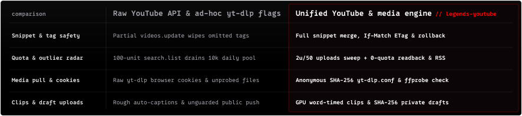

<a id="top"></a>

<p align="center"></p>

# legends-youtube: unified YouTube channel operations, Studio packaging, and verified yt-dlp archiving in plain english

[](https://github.com/avalonreset/legends-youtube/releases/latest)
[](https://github.com/avalonreset/legends-youtube/actions/workflows/ci.yml)
[](#reference)
[](docs/AGENT-RECIPE.md)
[](LICENSE)

Ask an unguided coding agent to update a YouTube video's description or pull a batch of reference clips with `yt-dlp`, and you hit four painful traps right away. Sending a partial `snippet` payload to YouTube's `videos.update` endpoint silently deletes your existing tags and language settings; calling `search.list` to inventory a channel burns 100 quota units per page; passing personal browser cookies into raw `yt-dlp` loops exposes your primary Google account to automated rate limits; and naive upload scripts risk publishing an unreviewed cut publicly.

**The human is the controller. The agents do the operating. Stop being your computer's assistant.**

`legends-youtube` unifies both halves of the YouTube workflow into one package exposing both `legends-youtube` and `legends-yt-dlp`. Register the [`cto-legends`](https://github.com/avalonreset/cto-legends) router once, state your goal in plain english, and your agent inventories channels for 2 quota units per 50 videos, scouts public outliers for 0 quota units, pulls verified `yt-dlp` media archives with local GPU word-timed clip plans, merges full `snippet` objects behind `If-Match` ETag locks, and freezes private-only draft uploads.

<p align="center"></p>

```text
Use cto-legends to install legends-youtube, run the doctor check for both
legends-youtube and legends-yt-dlp, and show me the plan before any download or channel write.
```

<p align="center"></p>

[Plain english](#hand-youtube-and-yt-dlp-to-your-agent-in-plain-english) · [Quota & lossless metadata](#why-raw-youtube-api-calls-wipe-tags-and-burn-quota) · [Verified yt-dlp & GPU clips](#anonymous-yt-dlp-probing-and-local-gpu-word-ledgers) · [Studio QA & private drafts](#pre-recording-idea-radar-studio-linters-and-private-draft-locks) · [Reference](#reference)

---

## Hand YouTube and yt-dlp to your agent in plain english

You should never have to hand-craft JSON payloads for `videos.update`, calculate YouTube Data API v3 quota costs on a notepad, or memorize `yt-dlp` and `ffmpeg` flags. You describe the job in plain english, and your coding agent connects `legends-youtube` with the rest of your studio and research stack.

<p align="center"></p>

Start where a creator or operator actually starts, with a sentence.

**"Sweep our channel inventory and score this video idea."**

Your agent inventories your uploads playlist at 2 quota units per 50 videos instead of burning 100 units per page on `search.list`, scouts breakout outlier videos on public channels for zero quota units via Atom RSS feeds, and evaluates your candidate topic with the Perfect Video Score, Goldilocks timing window, and Fit Filter before you spend a day recording in [`legends-obs`](https://github.com/avalonreset/legends-obs).

**"Pull this batch of reference videos and cut word-timed clips."**

Your agent invokes the bundled `legends-yt-dlp` engine (also reachable via `legends-youtube yt-dlp`, `archive`, `pull`, `transcribe`, and `clips`). It probes the channel or playlist into a reviewable `items.jsonl` ledger before downloading a byte, verifies an anonymous no-cookie `yt-dlp.conf` allowlist by SHA-256, checks every finished file with `ffprobe`, demuxes clean audio into local GPU Parakeet word ledgers, and builds frame-accurate FFmpeg clip plans ready for [`legends-captions`](https://github.com/avalonreset/legends-captions).

**"Migrate our legacy description links without wiping video tags."**

Your agent generates a SHA-256 preview plan with `links-migrate` and `metadata-plan`. When you approve, `metadata-apply` fetches each video's live `snippet`, verifies `expectedCurrent` fields, merges your updated description into the complete existing tag and language object, saves a local rollback snapshot, sends an `If-Match` ETag header, and verifies the live readback.

**"Audit our CTR scorecard and freeze a private draft upload."**

Your agent benchmarks click-through rate and retention against YouTube Help thresholds to rank candidates for Title and Thumbnail Test & Compare A/B runs, validates your chapter timestamps, Studio Video Quizzes, and custom thumbnail (`<= 2 MB`), and uploads the video strictly locked to `privacyStatus="private"`.

---

## Why raw YouTube API calls wipe tags and burn quota

Two architectural traps catch almost every developer who lets a raw language model call YouTube Data API v3 directly.

First, `PUT /youtube/v3/videos?part=snippet` replaces the entire `snippet` resource. If an unguided script sends only `title`, `description`, and `categoryId`, YouTube deletes the video's `tags`, `defaultLanguage`, and `defaultAudioLanguage`. Second, Google Cloud projects receive a 10,000-unit daily pool alongside granular daily method caps (`100` `search.list` calls per day and `100` `videos.insert` calls per day). Using `search.list` to list a 500-video channel burns 1,000 quota units; using authenticated API calls just to check a public video's live title wastes quota needed for real writes.

<p align="center"></p>

`legends-youtube` eliminates both failure modes. Channel inventory resolves `contentDetails.relatedPlaylists.uploads` and batches 50 video IDs per `videos.list` request, sweeping 500 videos for 21 total quota units. Public watch-page and `oEmbed` checks (`public-readback`) and RSS velocity scouting (`channel-outliers`) cost 0 quota units and require 0 credentials. And every metadata mutation is locked behind a lossless full-snippet merge, pre-write rollback JSON, `If-Match` ETag concurrency, and post-write readback verification.

---

## Anonymous yt-dlp probing and local GPU word ledgers

Media archiving and clip research belong in the same workflow as channel management, which is why `legends-yt-dlp` ships inside `legends-youtube` as a first-class console entrypoint and subcommand family.

<p align="center"></p>

When an agent runs `yt-dlp` without guardrails, it often passes `--cookies-from-browser`, downloads unprobed playlists blindly, or cuts clips mid-syllable from rough auto-captions. `legends-yt-dlp` enforces a strict look-then-do pipeline:

- **Probe first, download second.** `legends-yt-dlp inventory` expands channels and playlists into a reviewable `items.jsonl` ledger without downloading media, passes every URL after `"--"` to prevent option injection, and pauses immediately on rate limits or login walls.
- **Anonymous SHA-256 config lock and `ffprobe` stream checks.** Generated batch configs (`batches/<id>/yt-dlp.conf`) enforce `--ignore-config`, `--no-cookies`, and `--no-cookies-from-browser` under an option allowlist that blocks arbitrary command execution or proxy injection. The official `yt-dlp` binary is verified against upstream `SHA2-256SUMS`, `preflight` and `run` verify the `yt-dlp.conf` SHA-256 digest, and `verify` probes every completed media stream with `ffprobe -i`.
- **Local GPU Parakeet word ledgers and FFmpeg clips.** Once media files are verified, `intelligence transcribe` demuxes clean audio and runs local GPU CrispASR (Parakeet TDT) speech recognition with optional NVIDIA NeMo Forced Aligner refinement to produce word-accurate ledgers (`*.words.jsonl`), phrase search, reviewable FFmpeg clip plans, and Markdown transcript vaults for [`legends-empire`](https://github.com/avalonreset/legends-empire) and [`legends-ambient-intelligence`](https://github.com/avalonreset/legends-ambient-intelligence).

---

## Pre-recording Idea Radar, Studio linters, and private draft locks

Publishing a video involves more than an MP4 file. YouTube Studio rejects malformed chapter progressions, truncates quiz options over 80 characters, refuses custom thumbnails over 2 MB, and requires deliberate Shorts-to-long-form funnel linking.

`legends-youtube` validates all of those offline before you touch the network:

- **Pre-recording Idea Radar (`score-idea`) and Retention X-Ray (`retention-xray`).** Scores candidate ideas across timing (Day 4 to 30 Prime vs Day 31 to 180 Evergreen), search surface, proof advantage, and channel fit, compiles transcripts into chapters and Shorts gem-cuts (`transcript-package`), and aligns retention cliffs with exact spoken sentences.
- **Offline Studio linters (`chapters-lint`, `quiz-lint`, `thumbnail-check`, `related-guard`, `house-style-lint`).** Verifies `00:00` chapter starts, minimum 3 chapters, and `>= 10s` steps; validates Studio Video Quizzes (`ytve-posts-modal`, `<= 80` char options, `MM:SS:FF` timestamps); checks PNG/JPEG thumbnails (`<= 2 MB`); and guards Shorts `Related video` batch checklists.
- **Private-only draft uploads (`draft-freeze` -> `draft-upload`).** Freezes your video, title, description, and thumbnail into a SHA-256 manifest and executes resumable uploads hard-locked to `privacyStatus="private"` and `notifySubscribers=false` behind an explicit confirmation phrase.

---

## Reference

Everything you need to run `legends-youtube` and `legends-yt-dlp` through your coding agent is in the essay above. Open the drawers below for the full command table, lossless metadata and draft-upload examples, anonymous `yt-dlp` policies, and FAQ.

<details>
<summary><strong>Unified command surface and quick start (<code>legends-youtube</code> + <code>legends-yt-dlp</code>)</strong></summary>

<br>

| Surface | Subcommands | What It Does |
| :--- | :--- | :--- |
| **Readiness & Vault Resources** | `legends-youtube doctor`, `auth-status`, `knowledge-pack`, `paths`, `resources` | Verifies offline runtime health, OAuth/API-key scope readiness (`youtube.force-ssl`, `youtube.upload`), optional `--expected-channel-id` ownership, and the attachable YouTube Operations Vault. |
| **Quota & Channel Inventory** | `quota-plan`, `channel-inventory`, `video-inspect`, `public-readback` | Models daily quota waves, inventories uploads at 2 units per 50 videos, inspects batched video resources, and verifies public videos for 0 quota units. |
| **Idea Radar & Retention X-Ray** | `score-idea`, `channel-outliers`, `transcript-package`, `retention-xray` | Computes the Perfect Video Score, Goldilocks timing rule, and Fit Filter, scouts 0-quota RSS outliers, packages transcripts into chapters and Shorts gem-cuts, and maps retention cliffs to exact spoken lines. |
| **Lossless ETag Metadata & Links** | `metadata-plan`, `metadata-apply`, `links-audit`, `links-migrate` | Enforces SHA-256 plan hashes, `expectedCurrent` drift checks, full `snippet` field preservation merge, pre-write rollback snapshots, `If-Match` ETag concurrency, post-write readback verification, and HTTPS link-rot/CTA migrations. |
| **Analytics & Packaging A/B Queue** | `analytics-audit`, `packaging-audit` | Benchmarks Studio exports or live YouTube Analytics API v2 reports against official YouTube Help thresholds (`2%-10%` CTR band, `50%` APV, `8:00` mid-roll eligibility) and ranks high-impression below-median-CTR videos for Test & Compare A/B runs. |
| **Studio QA, Shorts & Private Drafts** | `chapters-lint`, `quiz-lint`, `thumbnail-check`, `related-guard`, `house-style-lint`, `comments-triage`, `playlists-audit`, `funnel-audit`, `draft-freeze`, `draft-upload` | Validates chapters (`00:00` start, `>= 3` items, `>= 10s` step), Studio Video Quizzes (`<= 10` quizzes, `<= 80` char options, `MM:SS:FF`), PNG/JPEG thumbnails (`<= 2 MB`), Shorts-to-Longform Related Video confirmation phrases, lowercase title rules, and SHA-256 frozen `privacyStatus="private"` resumable uploads. |
| **`yt-dlp` Probing & Guarded Capture** | `legends-yt-dlp doctor`, `onboard`, `yt-dlp install\|update\|version\|check`, `inventory`, `plan`, `smoke plan`, `catalog`, `ledger`, `preflight`, `run`, `verify` (or `legends-youtube yt-dlp\|archive\|pull ...`) | JSON readiness checks, SHA-256-verified upstream `yt-dlp` binary management, read-only channel/playlist item probing (`items.jsonl`), anonymous SHA-256 `yt-dlp.conf` preflight, paced capture (`--bulk` above 50 URLs, optional `--with-vpn` Mullvad Lockdown lifecycle), and ledger-scoped `ffprobe -i` stream verification. |
| **GPU Word Ledgers, Clips & Vault** | `legends-yt-dlp intelligence init\|doctor\|status\|transcribe\|import-crispasr\|import-words\|align nfa\|search\|clips plan\|clips render\|vault build` (or `legends-youtube transcribe\|clips ...`) | Local audio demuxing, CrispASR Parakeet GPU transcription, NeMo Forced Aligner word CTM refinement, exact contiguous phrase search, reviewable FFmpeg clip plans and rendering, and Markdown vault export. |

```sh
# 1. Verify offline Studio API readiness, the YouTube Operations Vault, and the yt-dlp control plane
legends-youtube doctor --json
legends-youtube knowledge-pack --json
legends-yt-dlp doctor --offline

# 2. Score a candidate video topic before recording (Perfect Video Score + Goldilocks timing)
legends-youtube score-idea --title "I Built an Agentic System to Score YouTube Ideas" --days-since-catalyst 14 --fit-checks 8 --json

# 3. Verify any public video or scout channel outliers for 0 quota units and 0 credentials
legends-youtube public-readback --video-id dQw4w9WgXcQ --json
legends-youtube channel-outliers --channel-id UC_x5XG1OV2P6uZZ5FSM9Ttw --threshold 2.0 --json

# 4. Plan daily quota waves and validate chapters, Studio quizzes, Shorts Related-video guards, and thumbnails
legends-youtube quota-plan --inventory-videos 120 --metadata-updates 120 --json
legends-youtube chapters-lint --description-file description.txt --duration-seconds 1800 --json
legends-youtube quiz-lint --quizzes-file quizzes.json --duration-seconds 1800 --json
legends-youtube thumbnail-check --image thumbnail.png --json

# 5. Probe a channel with yt-dlp, run anonymous SHA-256 preflight, verify streams with ffprobe, and cut GPU word clips
legends-yt-dlp inventory "https://www.youtube.com/@CHANNEL" --name "channel-review" --max-items 25
legends-yt-dlp preflight "batches/<batch-id>/manifest.json"
legends-yt-dlp run "batches/<batch-id>/manifest.json" --dry-run
legends-yt-dlp verify "batches/<batch-id>/manifest.json"
legends-yt-dlp intelligence transcribe "batches/<batch-id>/manifest.json" --all --model auto
legends-yt-dlp intelligence clips plan "batches/<batch-id>/manifest.json" --query "agentic workflow"
```

</details>

<details>
<summary><strong>Lossless metadata updates, private-draft upload flow, and <code>legends-empire</code> knowledge pack</strong></summary>

<br>

Every write surface in `legends-youtube` is split into a zero-mutation preview/freeze step and a hash-confirmed execution step:

```sh
# Preview and lock a lossless snippet update plan (0 YouTube mutations)
legends-youtube metadata-plan --plan update-plan.json --output preview.json

# Apply with SHA-256 plan verification, If-Match ETag concurrency, and readback check
legends-youtube metadata-apply \
  --plan update-plan.json \
  --expected-plan-sha256 SHA256_FROM_PREVIEW \
  --confirm \
  --output metadata-receipt.json

# Freeze a release package and upload strictly as a private draft
legends-youtube draft-freeze \
  --video video.mp4 \
  --title-file title.txt \
  --description-file description.txt \
  --thumbnail thumbnail.png \
  --channel-id UC_x5XG1OV2P6uZZ5FSM9Ttw \
  --output frozen-draft.json

legends-youtube draft-upload \
  --plan frozen-draft.json \
  --apply \
  --confirm-phrase "UPLOAD_PRIVATE_DRAFT UC_x5XG1OV2P6uZZ5FSM9Ttw" \
  --output upload-receipt.json
```

Read the [knowledge pack guide](docs/KNOWLEDGE-PACK.md), [vault index](wiki/index.md), [dated official sources ledger](references/sources.md), and [private operation receipt template](templates/private-operation-receipt.md) to attach the YouTube Operations Vault ([knowledge/youtube/pack.json](knowledge/youtube/pack.json)) to [`legends-empire`](https://github.com/avalonreset/legends-empire).

</details>

<details>
<summary><strong><code>yt-dlp</code> anonymous extraction policy, opt-in Mullvad VPN lifecycle, and agent setup</strong></summary>

<br>

All `legends-yt-dlp` (and `legends-youtube yt-dlp`) batches run anonymously by default: no browser cookies, no cookie files, no username or password flags, no `.netrc`, and no inherited user-level `yt-dlp` configuration. Batches of 11 to 50 URLs print a pacing notice; batches over 50 URLs require explicit `--bulk` acknowledgement.

- **Lawful & authorized use only:** Designed for archiving media you own, have permission to download, or access under public-domain or open licenses. Never use `legends-youtube` or `legends-yt-dlp` to bypass DRM, paywalls, captchas, login challenges, or access controls, and never rotate VPN relays to push through platform blocks.
- **Opt-in Mullvad VPN (`--with-vpn`):** Ordinary runs require no VPN and touch no Mullvad state. When `--with-vpn` is requested on `plan`, `inventory`, `preflight`, or `run`, `legends-yt-dlp` verifies that Mullvad is connected with Lockdown on, recovers from transient tunnel drops, and cleanly disables Lockdown and disconnects (`mullvad shutdown`) when `run --yes` completes (unless `--keep-vpn` is passed).
- **Subcommand forwarding:** You can invoke `legends-yt-dlp` directly or through `legends-youtube yt-dlp <args>`, `legends-youtube archive <args>`, `legends-youtube pull <args>`, `legends-youtube transcribe <args>`, and `legends-youtube clips <args>`.

See [docs/OPERATOR-ROUTING.md](docs/OPERATOR-ROUTING.md), [docs/CLI.md](docs/CLI.md), [docs/INTELLIGENCE.md](docs/INTELLIGENCE.md), [docs/CRISPASR.md](docs/CRISPASR.md), [docs/TRANSCRIPTION.md](docs/TRANSCRIPTION.md), [docs/VAULT-MAP.md](docs/VAULT-MAP.md), [docs/SAFETY.md](docs/SAFETY.md), [docs/SAFETY-AND-ERRORS.md](docs/SAFETY-AND-ERRORS.md), [docs/MULLVAD-CONTROLS.md](docs/MULLVAD-CONTROLS.md), and [docs/LEGAL.md](docs/LEGAL.md).

### Agent setup (via `cto-legends`)

Part of the [`cto-legends`](https://github.com/avalonreset/cto-legends) ecosystem. `cto-legends` is the only registered skill; this repository vendors a pinned copy at [skills/cto-legends/SKILL.md](skills/cto-legends/SKILL.md).

The product, repository, Python distribution, and catalog ID are `legends-youtube` (which installs both `legends-youtube` and `legends-yt-dlp` entrypoints, with `legends-yt-dlp` retained as a catalog alias).

```sh
git clone https://github.com/avalonreset/legends-youtube.git
cd legends-youtube
python -m pip install -e .
legends-youtube doctor --json
legends-youtube resources --json
legends-yt-dlp doctor --offline
```

Provide YouTube API credentials only through explicit environment variables (`YOUTUBE_API_KEY`, `YOUTUBE_ACCESS_TOKEN`, `YOUTUBE_REFRESH_TOKEN`, `YOUTUBE_CLIENT_ID`, `YOUTUBE_CLIENT_SECRET`), `--dotenv`, or `--token-file`. Browser cookie stores and system keyrings are never touched.

```sh
python scripts/check_release.py
python -m unittest discover -s tests -p "test_*.py" -v
python scripts/smoke_installed_resources.py
```

See [docs/RELEASE.md](docs/RELEASE.md) and [CHANGELOG.md](CHANGELOG.md) for release verification rules.

</details>

## Start here

Paste the [agent handoff block](#top) at the top of this page into your coding agent, let it wire the router, and describe the first channel audit, idea score, or verified `yt-dlp` archive batch you want to run.

<p align="center"><a href="https://github.com/stars/avalonreset/lists/cto-legends"></a></p>

Running a media-backed company and want this workflow wired directly into your own studio and publishing stack? Message Avalon Reset at [cto-legends.com/dm](https://cto-legends.com/dm). The desk is async, so the conversation starts the moment you write.

<p align="center"><a href="https://cto-legends.com/dm"></a></p>

See [CONTRIBUTING.md](CONTRIBUTING.md), [SUPPORT.md](SUPPORT.md), [CODE_OF_CONDUCT.md](CODE_OF_CONDUCT.md), and [SECURITY.md](SECURITY.md). MIT License. The project does not bundle or redistribute `yt-dlp.exe`; it downloads and checksum-verifies the official upstream release locally when requested. See [LICENSE](LICENSE), [NOTICE](NOTICE), [NOTICE.md](NOTICE.md), and [THIRD_PARTY_NOTICES.md](THIRD_PARTY_NOTICES.md). Not affiliated with, sponsored by, or endorsed by YouTube or Google LLC. Interactive specification: [cto-legends.com/modules/legends-youtube](https://cto-legends.com/modules/legends-youtube).
