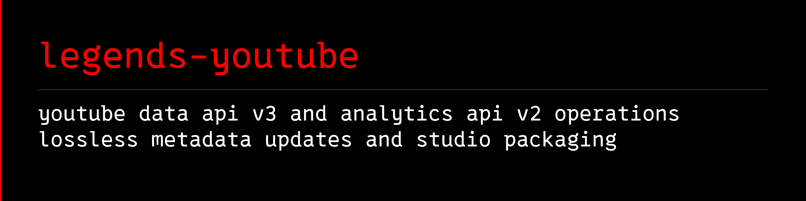
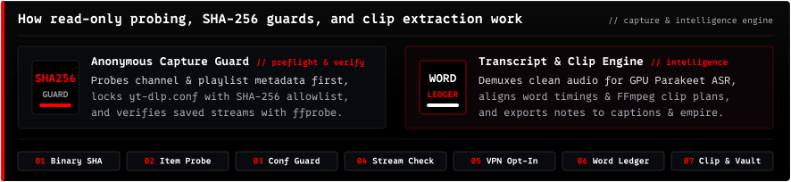
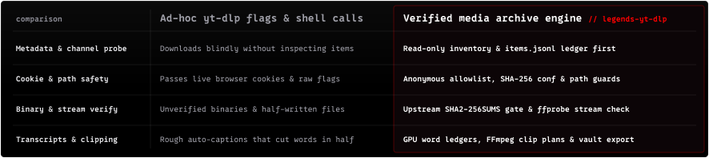

# 

[](https://github.com/avalonreset/legends-yt-dlp/releases/latest)
[](https://github.com/avalonreset/legends-yt-dlp/actions/workflows/contract.yml)
[](pyproject.toml)
[](pyproject.toml)
[](docs/MULLVAD-CONTROLS.md)
[](LICENSE)

**Preview-first `yt-dlp` video archiving, subtitle and transcript extraction, audio demuxing, and SHA-256 media provenance CLI for coding agents: probe channel and playlist metadata into a resumable ledger before downloading, enforce anonymous no-cookie pacing and option allowlists, verify every media stream with `ffprobe`, and extract GPU word ledgers and frame-accurate FFmpeg clips.**


```text
Install or update legends-yt-dlp via cto-legends (https://github.com/avalonreset/cto-legends): run `cto-legends install legends-yt-dlp --apply`, then `cto-legends handoff legends-yt-dlp` and follow the returned JSON recipe to verify `legends-yt-dlp`.
```


## Why `legends-yt-dlp` exists

Most ad-hoc `yt-dlp` invocations in agent sessions fail in three predictable ways:

1. **Passing live browser cookies and unverified flags into raw shell calls:** A raw chat suggestion tells your agent to pass `--cookies-from-browser chrome` or unvetted configuration flags, exposing your personal account to automated rate limits and allowing dangerous options like `--exec`, `--plugin-dirs`, or `--proxy`.
2. **Downloading blindly without probing metadata or verifying output streams:** Running a raw download loop across a channel or playlist gives you no pre-download item ledger, no pacing between pulls, and no check that the finished files contain valid video and audio streams rather than truncated partial downloads.
3. **Slicing clips from rough auto-captions that chop speakers mid-word:** Platform auto-captions drift across syllable boundaries. Cutting short-form clips or building subtitle timelines without a local word-timed ledger produces jarred cuts and broken active-word highlights.

`legends-yt-dlp` wraps the official checksum-verified `yt-dlp` executable and `ffmpeg` inside an isolated batch control plane (`batches/<id>/`). Every job inventories or plans an explicit manifest (`manifest.json`, `urls.txt`, `items.jsonl`, and a SHA-256-locked `yt-dlp.conf`), blocks real downloads until preflight passes, paces requests politely by default, verifies completed files with `ffprobe`, and optionally demuxes audio into GPU word ledgers for [`legends-captions`](https://github.com/avalonreset/legends-captions), [`legends-ambient-intelligence`](https://github.com/avalonreset/legends-ambient-intelligence), [`legends-youtube`](https://github.com/avalonreset/legends-youtube), and [`legends-empire`](https://github.com/avalonreset/legends-empire).

## Ask in plain english

Once [`cto-legends`](https://github.com/avalonreset/cto-legends) is installed, you ask your coding agent in plain english. It probes metadata or plans the batch first, runs anonymous preflight checks, paces the capture, and verifies the saved media streams:


## Architecture: read-only probing, SHA-256 guards, and clip extraction



### 1. Read-only metadata probing and SHA-256 batch preflight (`inventory`, `plan`, `preflight`)

Before downloading a single media byte, `legends-yt-dlp` separates metadata discovery from capture execution:

- **Channel & playlist item probing (`legends-yt-dlp inventory`):** Expands a channel or playlist into a reviewable `items.jsonl` ledger without downloading media. Every positional URL is validated and passed after `"--"` so option injection is impossible, and the runner pauses immediately if a source signals throttling, login walls, or captchas.
- **Anonymous config allowlist & SHA-256 lock (`yt-dlp.conf`):** Generated batch configs enforce `--ignore-config`, `--no-cookies`, and `--no-cookies-from-browser` under a strict option allowlist that blocks `--exec*`, `--alias`, `--plugin-dirs`, `--config-location*`, `--load-info-json`, `--print-to-file`, and `--proxy`. Both `preflight` and `run` verify the recorded SHA-256 digest of `yt-dlp.conf` before launching `yt-dlp`.
- **Upstream binary provenance (`legends-yt-dlp yt-dlp install | update | check`):** Fetches the official platform binary (`yt-dlp.exe`, `yt-dlp_macos`, or `yt-dlp_linux`) over HTTPS with TLS 1.2+, host allowlisting, `ProxyHandler({})`, symlink refusal, and staging-file verification against upstream `SHA2-256SUMS`, plus a 90-day freshness check.

### 2. Complete CLI command surface (`legends-yt-dlp`)

Every subcommand runs deterministically with `shell=False`, path-containment and symlink guards, and structured batch reports:

| Surface | `legends-yt-dlp` Subcommands | What It Does |
| :--- | :--- | :--- |
| **Readiness & Binary Provenance** | `doctor`, `onboard`, `yt-dlp install\|update\|version\|check` | JSON readiness checks (`doctor --offline`), non-mutating onboarding guidance (`onboard`), and SHA-256-verified upstream `yt-dlp` binary management. |
| **Metadata Probing & Planning** | `inventory`, `plan`, `smoke plan`, `catalog`, `ledger` | Read-only channel and playlist expansion (`inventory`), batch manifest creation (`plan`), bounded smoke jobs (`smoke plan`), catalog listing (`catalog`), and per-item status reconciliation (`ledger --refresh`). |
| **Guarded Capture & Verification** | `preflight`, `run`, `verify` | Config SHA-256 and anonymous-auth preflight (`preflight`), dry-run simulation (`run --dry-run`), paced capture (`run --yes`, `--bulk` above 50 URLs), and ledger-scoped `ffprobe -i` stream verification (`verify`). |
| **Opt-In Mullvad VPN Lifecycle** | `setup production`, `mullvad status\|connect\|recover\|shutdown\|...` | Optional `--with-vpn` guardrail requiring Mullvad connected with Lockdown on during capture, automatic tunnel recovery, and clean post-run Lockdown disable and disconnect (`mullvad shutdown`). |
| **Transcripts, Audio & Clip Engine** | `intelligence init\|doctor\|transcribe\|align nfa\|search\|clips\|vault` | Local audio demuxing, CrispASR Parakeet GPU transcription (`transcribe`), NeMo Forced Aligner word timing refinement (`align nfa`), exact phrase search (`search`), FFmpeg clip planning and rendering (`clips plan\|render`), and Obsidian vault export (`vault build`). |

### 3. Audio demuxing, word-timed transcripts, and downstream handoffs (`intelligence`)

- **Local GPU transcription & forced alignment:** `legends-yt-dlp intelligence transcribe` extracts audio from verified local video files and runs CrispASR (Parakeet TDT v3) locally to write normalized word ledgers (`intelligence/words/*.words.jsonl`). For delicate cuts, `intelligence align nfa` prepares and imports NVIDIA NeMo Forced Aligner word CTM timings when the word sequence matches the transcript.
- **Ecosystem handoffs:** Exported word ledgers, clips, and Markdown transcript cards connect cleanly into [`legends-captions`](https://github.com/avalonreset/legends-captions) for vertical 4K60 active-word subtitles, [`legends-ambient-intelligence`](https://github.com/avalonreset/legends-ambient-intelligence) for continuous audio archives, [`legends-hyperyap`](https://github.com/avalonreset/legends-hyperyap) for live voice dictation, and [`legends-empire`](https://github.com/avalonreset/legends-empire) for source-cited vault notes.

## Ad-hoc `yt-dlp` calls vs `legends-yt-dlp`



## Quick start

```sh
# 1. Check control-plane readiness and upstream yt-dlp binary provenance
legends-yt-dlp doctor --offline
legends-yt-dlp yt-dlp check

# 2. Probe a channel or playlist into a reviewable items.jsonl ledger without downloading media
legends-yt-dlp inventory "https://www.youtube.com/@CHANNEL" --name "channel-review" --max-items 25
legends-yt-dlp ledger "batches/<batch-id>/manifest.json"

# 3. Plan a bounded batch from direct URLs or a URL file
legends-yt-dlp plan --from-file "./examples/urls.txt" --name "reference-clips" --folder-policy batch

# 4. Run SHA-256 config preflight, dry-run simulation, paced capture, and ffprobe stream verification
legends-yt-dlp preflight "batches/<batch-id>/manifest.json"
legends-yt-dlp run "batches/<batch-id>/manifest.json" --dry-run
legends-yt-dlp run "batches/<batch-id>/manifest.json" --yes
legends-yt-dlp verify "batches/<batch-id>/manifest.json"
legends-yt-dlp ledger "batches/<batch-id>/manifest.json" --refresh

# 5. Optional: transcribe verified local media on GPU, search phrases, cut clips, and build vault notes
legends-yt-dlp intelligence init "batches/<batch-id>/manifest.json"
legends-yt-dlp intelligence doctor "batches/<batch-id>/manifest.json" --require-gpu
legends-yt-dlp intelligence transcribe "batches/<batch-id>/manifest.json" --all --model auto
legends-yt-dlp intelligence search "batches/<batch-id>/manifest.json" "agentic workflow"
legends-yt-dlp intelligence clips plan "batches/<batch-id>/manifest.json" --query "agentic workflow"
legends-yt-dlp intelligence vault build "batches/<batch-id>/manifest.json"
```

## Reference

<details>
<summary><strong>Safety boundaries, anonymous extraction policy, and opt-in Mullvad lifecycle</strong></summary>

All batches run anonymously by default: no browser cookies, no cookie files, no username or password flags, no `.netrc`, and no inherited user-level `yt-dlp` configuration. Batches of 11 to 50 URLs print a pacing notice; batches over 50 URLs require explicit `--bulk` acknowledgement.

- **Lawful & authorized use only:** Designed for archiving media you own, have permission to download, or access under public-domain or open licenses. Never use `legends-yt-dlp` to bypass DRM, paywalls, captchas, login challenges, or access controls, and never rotate VPN relays to push through platform blocks.
- **Opt-in Mullvad VPN (`--with-vpn`):** Ordinary runs require no VPN and touch no Mullvad state. When `--with-vpn` is requested on `plan`, `inventory`, `preflight`, or `run`, `legends-yt-dlp` verifies that Mullvad is connected with Lockdown on, recovers from transient tunnel drops, and cleanly disables Lockdown and disconnects (`mullvad shutdown`) when `run --yes` completes (unless `--keep-vpn` is passed).

See [docs/SAFETY.md](docs/SAFETY.md), [docs/SAFETY-AND-ERRORS.md](docs/SAFETY-AND-ERRORS.md), [docs/MULLVAD-CONTROLS.md](docs/MULLVAD-CONTROLS.md), and [docs/LEGAL.md](docs/LEGAL.md).

</details>

<details>
<summary><strong>Agent setup (via <code>cto-legends</code>) and standalone installation</strong></summary>

### Agent setup (via `cto-legends`)

Part of [cto-legends](https://github.com/avalonreset/cto-legends). The central router skill is vendored at [skills/cto-legends/SKILL.md](skills/cto-legends/SKILL.md); this module is not a separate registered skill and does not require an ambient MCP daemon.

Run `cto-legends handoff legends-yt-dlp` and read the returned installed recipe and task-readiness checks. If the module is missing, preview setup with `cto-legends install legends-yt-dlp`, perform the authorized setup, then repeat the handoff. Use `cto-legends check-updates` to compare your installed version with the catalog and published release. See [docs/AGENT-RECIPE.md](docs/AGENT-RECIPE.md) and [docs/OPERATOR-ROUTING.md](docs/OPERATOR-ROUTING.md) for the standalone recipe.

```sh
python -m pip install -e .
legends-yt-dlp doctor --offline
```

`.env` is ignored by git (see `.env.example` for optional `MULLVAD_ACCOUNT_NUMBER` or `CRISP_ASR_BIN` settings).

</details>

<details>
<summary><strong>Repository layout, documentation index, and verification</strong></summary>

```text
Operator / Agent (`legends-yt-dlp`)
  -> Read-only inventory & batch plan (`manifest.json`, `items.jsonl`, SHA-256 `yt-dlp.conf`)
  -> Anonymous preflight gate & optional `--with-vpn` Mullvad Lockdown check
  -> Paced `yt-dlp` capture (`shell=False`) & ledger-scoped `ffprobe -i` stream verification
  -> Optional `intelligence` GPU word ledger, FFmpeg clip plans, and Empire vault export
```

- `src/legends_ytdlp/`: Console entrypoints (`legends-yt-dlp`, `legends-ytdlp`, `python -m legends_ytdlp`), `batch.py`, `inventory.py`, `ledger.py`, `verify.py`, `intelligence.py`, `mullvad.py`, and `tools.py`.
- `docs/`: [CLI Commands](docs/CLI.md), [First-Run Walkthrough](docs/WALKTHROUGH.md), [Standard Operating Procedure](docs/SOP.md), [Architecture](docs/ARCHITECTURE.md), [Post-Capture Intelligence](docs/INTELLIGENCE.md), [CrispASR Backend](docs/CRISPASR.md), [Transcription Routes](docs/TRANSCRIPTION.md), [Empire Vault Map](docs/VAULT-MAP.md), [Batch Catalog](docs/BATCH-CATALOG.md), [Packaging](docs/PACKAGING.md), and [Search Strategy](docs/SEARCH-STRATEGY.md).
- `skills/cto-legends/SKILL.md`: Pinned copy of the central [`cto-legends`](https://github.com/avalonreset/cto-legends) router skill.

```sh
python -m unittest discover -s tests -p "test_*.py" -v
python scripts/check_release.py
```

</details>

## Contributing, security, and license

See [CONTRIBUTING.md](CONTRIBUTING.md), [SUPPORT.md](SUPPORT.md), and [SECURITY.md](SECURITY.md).

MIT License. The project does not bundle or redistribute `yt-dlp.exe`; it downloads and checksum-verifies the official upstream release locally. See [LICENSE](LICENSE), [NOTICE](NOTICE), and [THIRD_PARTY_NOTICES.md](THIRD_PARTY_NOTICES.md). Copyright (c) 2026 Avalon Reset.

[](https://github.com/avalonreset/cto-legends/issues/new?title=Message%20for%20Avalon%20Reset&labels=message)

<p align="center"><a href="https://github.com/stars/avalonreset/lists/cto-legends"></a></p>

**Specification & benchmarks on cto-legends.com:**
- **Module specification & architecture matrix:** [cto-legends.com/modules/legends-yt-dlp](https://cto-legends.com/modules/legends-yt-dlp)
- **Related engineering dispatches:** [How to Build AI Agents: Production CLI & MCP Routing](https://cto-legends.com/blog?post=how-to-build-ai-agents-cli-mcp-routing) · [Obsidian Second Brain: Markdown Knowledge Base Guide](https://cto-legends.com/blog?post=obsidian-second-brain-markdown-knowledge-base) · [Claude Code Skills: MCP vs CLI Workflow Architecture](https://cto-legends.com/blog?post=claude-code-skills-mcp-vs-cli-workflow)
- **Ecosystem hub:** [cto-legends.com/home](https://cto-legends.com/home)
